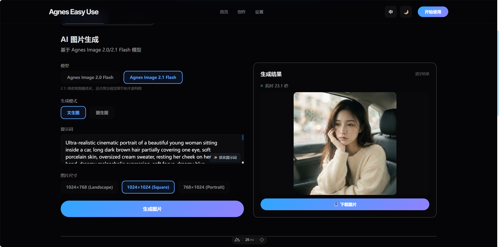

# Agnes Easy Use

> **Language / 语言**：[简体中文](README.md) · [English](README.en.md)

An out-of-the-box, visual creation tool for Agnes AI that integrates image generation, video generation, and prompt optimization. It supports **dual-site switching** between the **Agnes International site (agnes-ai.com)** and the **China site (agnes-ai.cn)**.

This project is completely free, open-source, and self-hostable. Just fill in your own Agnes API Key and start using Agnes image, video, and text capabilities right in your browser—no need to hand-write API requests.

> If this project saved you some trouble, a Star is much appreciated. It tells me this little tool is actually being used.

## Highlights

- **Permanently unlimited & free**: the code is open-source, with no paid tiers, no usage caps, and no lock-in.
- **Dual-site support**: switch between the international and China sites in one click. Keys for both sites are stored separately and routed automatically to the correct API.
- Integrated with Agnes: connected to Agnes image, video, and text model endpoints. The model lineup stays in sync with the official documentation.
- Visual workflow: create through forms—no need to assemble API parameters by hand.
- Local Key storage: the API Key lives in your browser (localStorage) and also supports server-side environment variables.
- Self-hostable: deploy to your own server, Vercel, Cloudflare Pages, or any Node/Nuxt environment.
- Bilingual UI: built-in i18n with language switching.
- Light / dark theme: both modes supported.
- Mobile-friendly: responsive layout, works on phones and tablets.

## Demo

### AI Image Generation



## Try It Now

Don't want to deploy locally? **Experience it online** 👉 [**Click here**](https://agneseasyuse.2025521.xyz/)

Fill in your Agnes API Key and start creating—no dependencies to install.

## International / China Site Notes

Agnes AI offers two completely independent sites. **Accounts, API Keys, and billing are not shared between them:**

| Site | Console / Docs | API Base URL | Get API Key |
| --- | --- | --- | --- |
| International | [agnes-ai.com](https://agnes-ai.com/zh-Hans/docs/overview) | `https://apihub.agnes-ai.com` | [platform.agnes-ai.com/settings/apiKeys](https://platform.agnes-ai.com/settings/apiKeys) |
| China | [agnes-ai.cn](https://agnes-ai.cn/zh-Hans/docs/overview) | `https://api.agnes-ai.cn` | [platform.agnes-ai.cn/settings/apiKeys](https://platform.agnes-ai.cn/settings/apiKeys) |

How to use:

- In the **Settings** page, switch sites at the top and save the API Key for each site separately (Keys are stored only in your browser).
- The **Create** page also has a site switcher at the top. Once switched, all image / video / prompt-optimization requests are routed to the selected site.
- Both sites share the same model lineup. A legacy single-site Key is automatically migrated to act as the fallback Key for the current site.

## Integrated Agnes Features

### Image Generation

Supports Agnes image models (currently **all free**, including every 1K–4K output tier and input reference images):

- `agnes-image-2.0-flash` — fast generation, exact dimensions (1024×768, etc.)
- `agnes-image-2.1-flash` — high-density image optimization, multi-image composition
- `agnes-image-2.5-flash` (**default**, the latest generation, with capabilities that comprehensively exceed 2.1)

Implemented features:

- Text-to-image
- Image-to-image
- Multi-image reference generation (supported by all three models; input images go through `extra_body.image`)
- Tiered sizes: `1K / 2K / 3K / 4K` + aspect ratio `1:1 / 3:4 / 4:3 / 16:9 / 9:16 / 2:3 / 3:2 / 21:9` (2.1 / 2.5 Flash)
- Image result preview
- Image download
- Generation history

### Video Generation

Supports Agnes video models (both models share the 2.5 series contract: `mode / seconds / aspect_ratio`):

- `agnes-video-2.5-flash` (**default**) — fixed 720P, supports 4–12 seconds, first/last frames and reference-image generation (`text` / `keyframe` / `reference` modes), up to 5 reference images, **currently free during a limited period**
- `agnes-video-2.5` — full version, supports `720P / 1080P / 1K / 2K` resolution tiers, billed by resolution (China site: 720P ¥0.15/sec, 1080P/1K ¥0.25/sec, 2K ¥0.35/sec)

Implemented features:

- Text-to-video
- Image-to-video (first frame)
- Multi-image video (reference images, Flash up to 5 / full version up to 10)
- Keyframe video (first frame + last frame)
- Aspect-ratio selection (21:9 / 16:9 / 4:3 / 1:1 / 3:4 / 9:16)
- Resolution tier selection (full version only)
- Duration selection (4–12 seconds, customizable)
- Task status polling (carries `model_name` in the query—the officially recommended universal approach)
- Video preview and download

> Note: the legacy model `agnes-video-v2.0` has been removed from the official docs, so this project has dropped it too; its custom resolution / frame-rate / negative-prompt parameters are deprecated as well.

### Prompt Optimization

Supports Agnes text models (currently **free on both sites**):

- `agnes-2.5-flash` (**default**, the full upgrade of `agnes-2.0-flash`, API-compatible)
- `agnes-3.0-flash` (new generation, stronger instruction-following and output completeness)

Both models share the OpenAI-compatible `/v1/chat/completions` endpoint and can be switched in the "Optimizer model" selector at the top of the Create page.

Implemented features:

- Turns a brief description into a prompt that's better suited for AI image / video generation
- Automatically adds style, lighting, composition, and quality details
- One-click backfill into the input box

### Deprecated Models (Removed)

| Model | Type | Reason for removal |
| --- | --- | --- |
| `agnes-2.0-flash` | Text | Officially deprecated; replaced by the API-compatible `agnes-2.5-flash` (locally saved legacy selections migrate automatically) |
| `agnes-video-v2.0` | Video | Removed from official docs; superseded by `agnes-video-2.5` / `agnes-video-2.5-flash` |

## Free-Pricing Note

This project is **permanently and unlimitedly free**:

- ✅ No paid membership, no usage caps, no fees of any kind
- ✅ No API relay/proxy fees
- ✅ No limits on self-hosting
- ✅ Not tied to any commercial backend
- ✅ Your API Key is never uploaded to the author's server (Key stored only in your browser or server-side env vars)

> 💡 You only need to provide your own Agnes API Key to use it. The project is just a free client; actual model calls are served by the Agnes API.
>
> Agnes's official free quota (per the [official pricing page](https://agnes-ai.cn/zh-Hans/docs/pricing)):
>
> | Model | Free status |
> | --- | --- |
> | `agnes-2.5-flash` / `agnes-3.0-flash` (text) | ✅ Currently fully free |
> | `agnes-image-2.0/2.1/2.5-flash` (image) | ✅ All tiers currently free |
> | `agnes-video-2.5-flash` (video) | ✅ Limited-time free |
> | `agnes-video-2.5` (full video) | 💰 Billed by resolution |

## Quick Start

### 1. Clone the repository

```bash
git clone https://github.com/dmw-net/agnes_easyUse.git
cd agnes_easyUse/nuxt-app
```

### 2. Install dependencies

```bash
npm install
```

### 3. Start the dev server

```bash
npm run dev
```

Access by default at:

```text
http://localhost:3000
```

### 4. Configure the Agnes API Key

After opening the page, go to the **Settings** page, select a site at the top (international / China), and enter that site's Agnes API Key.

You can also configure it via environment variables (server-side fallback, used when the frontend has no Key):

```bash
AGNES_API_KEY=your_global_site_api_key      # International site agnes-ai.com
AGNES_API_KEY_CN=your_china_site_api_key    # China site agnes-ai.cn
```

## Project Structure

```text
.
├── nuxt-app/                         # Nuxt 3 main app
│   ├── pages/                        # Pages
│   │   ├── create.vue                # Image/video creation page (with site switcher)
│   │   ├── settings.vue              # Dual-site API Key settings page
│   │   └── index.vue                 # Home page
│   ├── server/
│   │   ├── api/                      # Agnes API server-side proxies (all support `site` routing)
│   │   │   ├── generate/image.post.ts    # Image generation
│   │   │   ├── generate/video.post.ts    # Video generation (2.5 / 2.5-flash)
│   │   │   ├── optimize-prompt.post.ts   # Prompt optimization (2.5 / 3.0-flash)
│   │   │   └── video/status.get.ts       # Video status query
│   │   └── utils/agnes.ts            # Site registry: dual Base URL + Key resolution
│   ├── composables/useApiKey.ts      # Dual-site Key management (localStorage)
│   ├── i18n/locales/                 # Chinese/English locale files (single source of truth for @nuxtjs/i18n)
│   └── package.json
├── docs/
│   ├── screenshot-image-gen.png      # Screenshot referenced by the README (the rest of docs/ is not committed by default, except images)
│   ├── CHANGELOG.md                  # Changelog (kept locally, not committed by default)
│   └── BUGS.md                       # Known-issues log (kept locally, not committed by default)
└── README.md
```

## Deployment

This is a Nuxt 3 project and can be deployed to any platform that supports Node.js.

Common commands:

```bash
cd nuxt-app
npm run build
npm run preview
```

When deploying to a cloud platform, it's recommended to set environment variables:

```text
AGNES_API_KEY=your_global_site_api_key      # International site fallback Key (optional)
AGNES_API_KEY_CN=your_china_site_api_key    # China site fallback Key (optional)
```

You can also skip environment variables and let users fill in their own API Keys in the frontend Settings page.

## Security Notes

- For personal local use, you can simply fill in your API Key on the Settings page.
- For public deployment shared by many users, it's recommended to set API Keys via server-side environment variables.
- Don't hard-code a real API Key in the source.
- Never commit `.env` files to the repository.

## Changelog

The changelog is kept in the local `docs/CHANGELOG.md` and, by convention, is not committed to the repo (the `docs/` directory commits images only).

## Star This Repo

If you find this project useful, feel free to drop a Star:

[GitHub: dmw-net/agnes_easyUse](https://github.com/dmw-net/agnes_easyUse)

A Star costs nothing but means a lot to open-source projects:

- It helps more people discover this tool
- It gives the author motivation to keep maintaining it
- It also makes it easier for you to find your way back later

## Sponsor

☕ This project is **permanently and unlimitedly free and open-source**. If it saved you time, sparked creative inspiration, or you just find it handy, donations are welcome—any amount, any time.

Every contribution directly motivates me to keep maintaining it, adapting to more Agnes capabilities, and improving the user experience.

If you'd like to treat me to a coffee ☕, [**click here**](https://agneseasyuse.2025521.xyz/settings#sponsor) to reach the sponsorship page.

No sponsorship is absolutely fine—dropping a Star is already great 💙

## Tech Stack

- Nuxt 3
- Vue 3
- TypeScript
- Tailwind CSS
- Agnes API (International site apihub.agnes-ai.com / China site api.agnes-ai.cn)

## License

MIT License
