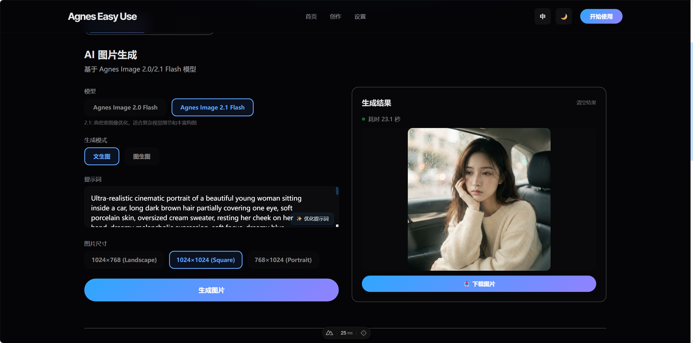

# Agnes Easy Use

一个开箱即用的 Agnes AI 可视化创作工具，集成图片生成、视频生成和提示词优化能力，同时支持 **Agnes 国际站（agnes-ai.com）** 与 **国内站（agnes-ai.cn）** 双站点切换。

本项目完全免费、开源、可自部署。你只需要填入自己的 Agnes API Key，就可以在网页里直接使用 Agnes 的图片、视频和文本能力，不需要自己手写接口请求。

> 如果这个项目帮你少折腾了一点，欢迎点一个 Star。它会让我知道这个小工具真的有人在用。

## 核心亮点

- **永久无限免费**：项目代码免费开源，不收取任何额外服务费，无会员、无限制、无绑定。
- **双站点支持**：国际站 / 国内站一键切换，两站 Key 独立保存，自动路由到对应 API。
- 集成 Agnes：已接入 Agnes 图片、视频和文本模型接口，模型阵容与官方文档保持同步。
- 可视化操作：用表单完成创作，不需要自己拼 API 参数。
- 本地保存 Key：API Key 存在浏览器本地，也支持服务端环境变量。
- 支持自部署：可以部署到自己的服务器、Vercel、Cloudflare Pages 或其他 Node/Nuxt 环境。
- 中英文界面：内置 i18n，多语言切换。
- 深浅色主题：支持浅色和深色模式。
- 移动端适配：响应式布局，手机/平板均可正常使用。

## 效果演示

### AI 图片生成



## 立即体验

不想本地部署？**直接在线体验** 👉 [**点击此处立即体验**](https://agneseasyuse.2025521.xyz/)

填入你的 Agnes API Key 即可开始创作，无需安装任何依赖。

## 国际站 / 国内站说明

Agnes AI 提供两个相互独立的站点，**账号、API Key 和计费均不互通**：

| 站点 | 控制台 / 文档 | API Base URL | 获取 API Key |
| --- | --- | --- | --- |
| 国际站 | [agnes-ai.com](https://agnes-ai.com/zh-Hans/docs/overview) | `https://apihub.agnes-ai.com` | [platform.agnes-ai.com/settings/apiKeys](https://platform.agnes-ai.com/settings/apiKeys) |
| 国内站 | [agnes-ai.cn](https://agnes-ai.cn/zh-Hans/docs/overview) | `https://api.agnes-ai.cn` | [platform.agnes-ai.cn/settings/apiKeys](https://platform.agnes-ai.cn/settings/apiKeys) |

使用方式：

- 在「设置」页顶部切换站点，分别保存两站的 API Key（Key 仅存浏览器本地）。
- 在「创作」页顶部也有站点切换器，切换后所有图片 / 视频 / 提示词优化请求都会路由到所选站点。
- 两站模型阵容一致；旧版单站点 Key 会自动迁移为当前站点使用的兜底 Key。

## 已集成的 Agnes 功能

### 图片生成

支持 Agnes 图片模型（当前**全部免费**，含 1K–4K 所有输出档位与输入参考图）：

- `agnes-image-2.0-flash` — 快速生成，精确尺寸（1024×768 等）
- `agnes-image-2.1-flash` — 高密度图像优化，支持多图合成
- `agnes-image-2.5-flash`（**默认**，最新一代，能力全面超过 2.1）

已实现能力：

- 文生图
- 图生图
- 多图参考生成（三个模型均支持，输入图统一走 `extra_body.image`）
- 档位式尺寸：`1K / 2K / 3K / 4K` + 宽高比 `1:1 / 3:4 / 4:3 / 16:9 / 9:16 / 2:3 / 3:2 / 21:9`（2.1 / 2.5 Flash）
- 图片结果预览
- 图片下载
- 生成历史记录

### 视频生成

支持 Agnes 视频模型（两模型共用 2.5 系列契约：`mode / seconds / aspect_ratio`）：

- `agnes-video-2.5-flash`（**默认**）— 固定 720P，支持 4–12 秒、首尾帧与参考图生成（`text` / `keyframe` / `reference` 三种模式），参考图最多 5 张，**当前限时免费**
- `agnes-video-2.5` — 全量版，支持 `720P / 1080P / 1K / 2K` 分辨率档位，按分辨率计费（国内站 720P ¥0.15/秒、1080P/1K ¥0.25/秒、2K ¥0.35/秒）

已实现能力：

- 文生视频
- 图生视频（首帧）
- 多图视频（参考图，Flash 最多 5 张 / 全量版最多 10 张）
- 关键帧视频（首帧 + 尾帧）
- 画幅比例选择（21:9 / 16:9 / 4:3 / 1:1 / 3:4 / 9:16）
- 分辨率档位选择（仅全量版）
- 时长选择（4–12 秒，支持自定义）
- 任务状态轮询（携带 `model_name` 查询，官方推荐的通用方式）
- 视频预览和下载

> 说明：旧模型 `agnes-video-v2.0` 已从官方文档下线，本项目同步移除；其自定义分辨率 / 帧率 / 负向提示词等参数也一并下架。

### 提示词优化

支持 Agnes 文本模型（当前**两站均免费**）：

- `agnes-2.5-flash`（**默认**，`agnes-2.0-flash` 的全量升级替代，API 兼容）
- `agnes-3.0-flash`（新一代，强化指令遵循与输出完整性）

两个模型共用 OpenAI 兼容的 `/v1/chat/completions` 接口，可在创作页顶部的「优化模型」中切换。

已实现能力：

- 将简单描述优化成更适合 AI 绘图 / 视频的提示词
- 自动补充风格、光影、构图、画质等描述
- 一键回填到输入框

### 已下架的废弃模型

| 模型 | 类型 | 下架原因 |
| --- | --- | --- |
| `agnes-2.0-flash` | 文本 | 官方已废弃，由 API 兼容的 `agnes-2.5-flash` 平替（本地保存的旧选择会自动迁移） |
| `agnes-video-v2.0` | 视频 | 已从官方文档移除，由 `agnes-video-2.5` / `agnes-video-2.5-flash` 取代 |

## 免费说明

本项目**永久无限免费**：

- ✅ 不卖会员、不限次数、不收任何费用
- ✅ 不收接口中转费
- ✅ 不限制本地部署
- ✅ 不绑定任何商业后台
- ✅ 不上传你的 API Key 到作者服务器（Key 仅存浏览器本地或服务端环境变量）

> 💡 你只需要提供自己的 Agnes API Key 即可使用。项目只是一个免费客户端，实际模型调用由 Agnes API 提供。
>
> Agnes 官方当前的免费额度（以[官方定价页](https://agnes-ai.cn/zh-Hans/docs/pricing)为准）：
>
> | 模型 | 免费状态 |
> | --- | --- |
> | `agnes-2.5-flash` / `agnes-3.0-flash`（文本） | ✅ 当前完全免费 |
> | `agnes-image-2.0/2.1/2.5-flash`（图片） | ✅ 所有档位当前免费 |
> | `agnes-video-2.5-flash`（视频） | ✅ 限时免费 |
> | `agnes-video-2.5`（视频全量版） | 💰 按分辨率计费 |

## 快速开始

### 1. 克隆项目

```bash
git clone https://github.com/dmw-net/agnes_easyUse.git
cd agnes_easyUse/nuxt-app
```

### 2. 安装依赖

```bash
npm install
```

### 3. 启动开发服务

```bash
npm run dev
```

默认访问：

```text
http://localhost:3000
```

### 4. 配置 Agnes API Key

打开页面后进入“设置”页面，先在顶部选择站点（国际站 / 国内站），再填入对应站点的 Agnes API Key。

也可以通过环境变量配置（服务端兜底，前端未配置 Key 时生效）：

```bash
AGNES_API_KEY=your_global_site_api_key      # 国际站 agnes-ai.com
AGNES_API_KEY_CN=your_china_site_api_key    # 国内站 agnes-ai.cn
```

## 项目结构

```text
.
├── nuxt-app/                         # Nuxt 3 主应用
│   ├── pages/                        # 页面
│   │   ├── create.vue                # 图片/视频创作页（含站点切换器）
│   │   ├── settings.vue              # 双站点 API Key 设置页
│   │   └── index.vue                 # 首页
│   ├── server/
│   │   ├── api/                      # Agnes API 服务端代理（均支持 site 路由）
│   │   │   ├── generate/image.post.ts    # 图片生成
│   │   │   ├── generate/video.post.ts    # 视频生成（2.5 / 2.5-flash）
│   │   │   ├── optimize-prompt.post.ts   # 提示词优化（2.5 / 3.0-flash）
│   │   │   └── video/status.get.ts       # 视频状态查询
│   │   └── utils/agnes.ts            # 站点注册表：双 Base URL + Key 解析
│   ├── composables/useApiKey.ts      # 双站点 Key 管理（localStorage）
│   ├── i18n/locales/                 # 中英文语言包（@nuxtjs/i18n 唯一数据源）
│   └── package.json
├── docs/
│   ├── CHANGELOG.md                  # 更新记录
│   └── BUGS.md                       # 已知问题与修复记录
└── README.md
```

## 部署

这是一个 Nuxt 3 项目，可以部署到支持 Node.js 的平台。

常用命令：

```bash
cd nuxt-app
npm run build
npm run preview
```

如果部署到云平台，建议配置环境变量：

```text
AGNES_API_KEY=your_global_site_api_key      # 国际站兜底 Key（可选）
AGNES_API_KEY_CN=your_china_site_api_key    # 国内站兜底 Key（可选）
```

当然，也可以不配置环境变量，让用户在前端设置页自行填写 API Key。

## 安全提示

- 如果是个人本地使用，可以直接在设置页填写 API Key。
- 如果是公开部署给多人使用，建议用服务端环境变量配置 API Key。
- 不建议把真实 API Key 写死在代码里。
- 不要把 `.env` 文件提交到仓库。

## 更新记录

详见 [docs/CHANGELOG.md](docs/CHANGELOG.md)。

## 求一个 Star

如果你觉得这个项目有用，欢迎顺手点个 Star：

[GitHub: dmw-net/agnes_easyUse](https://github.com/dmw-net/agnes_easyUse)

Star 不花钱，但对开源项目非常有帮助：

- 让更多人看到这个工具
- 给作者一点继续维护的动力
- 也方便你以后回来找到项目

## 赞赏支持

☕ 项目**永久无限免费开源**。如果它帮你节省了时间、激发了创作灵感，或者单纯觉得好用，欢迎随缘赞赏。

每一份赞赏都会直接激励我继续维护、适配更多 Agnes 能力，以及优化用户体验。

如果你愿意请我喝杯咖啡 ☕，[**点击此处**](https://agneseasyuse.2025521.xyz/settings#sponsor) 前往赞赏页

没有赞赏也完全没关系，点个 Star 就已经很够意思了 💙

## 技术栈

- Nuxt 3
- Vue 3
- TypeScript
- Tailwind CSS
- Agnes API（国际站 apihub.agnes-ai.com / 国内站 api.agnes-ai.cn）

## 许可证

MIT License
